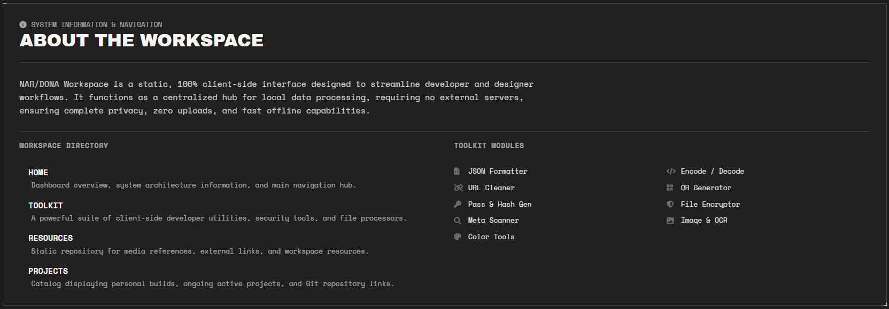
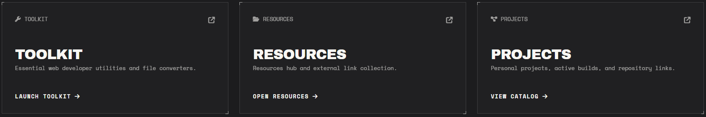

# NAR/DONA | Personal Workspace

## 🛠️ Toolkit Modules

This workspace is equipped with various essential utility modules that can be accessed instantly:

* **JSON Formatter & Validator**: Cleans, validates, and beautifies raw JSON data structures.
* **String Encoder & Decoder**: Supports Base64, URL Encoding, and HTML Entities conversions back and forth.
* **URL Privacy Cleaner**: Strips tracking parameters (*utm_source*, *fbclid*, *gclid*, etc.) from URLs for cleaner and safer sharing.
* **Offline QR Generator**: An instant QR code generator that operates 100% locally without an internet connection.
* **Password & Hash Generator**: Generates strong customizable passwords as well as cryptographic hash checksums (MD5, SHA-256, SHA-512).
* **AES-GCM File Encryptor**: Secure client-side file encryption and decryption using modern cryptography standards.
* **Universal Metadata Scanner**: In-depth file metadata inspector including GPS privacy risk detection on images.
* **Image Converter, EXIF Stripper & OCR**: Converts image formats (JPG, WEBP, PNG), strips sensitive EXIF data, and extracts text from images (*OCR*).
* **Color Tools & Visualizer**: Interactive color palette complete with a Color Wheel and precise Hue, Saturation, and Value sliders.

---

## 📂 Workspace Directory

* **`HOME`**: Dashboard overview, system architecture information, and main navigation hub.
* **`TOOLKIT`**: A collection of developer utilities, security tools, and file processors.
* **`RESOURCES`**: Static repository for media references and external links.
* **`PROJECTS`**: Portfolio catalog displaying personal builds, active builds, and Git repository links.

---
